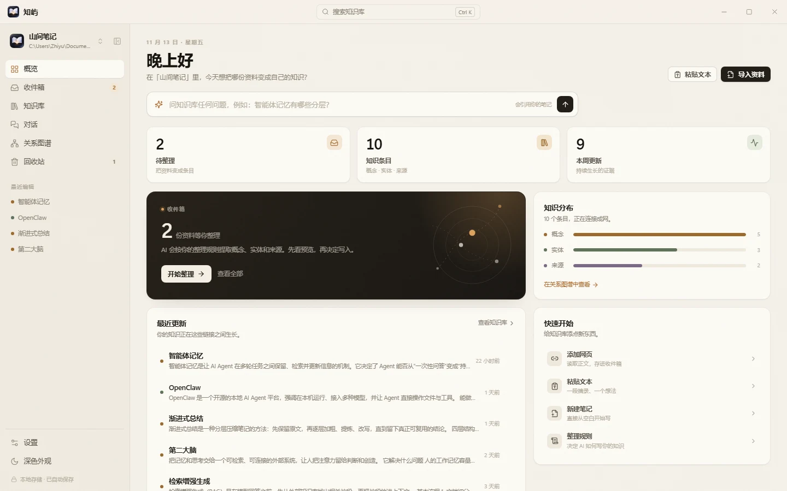
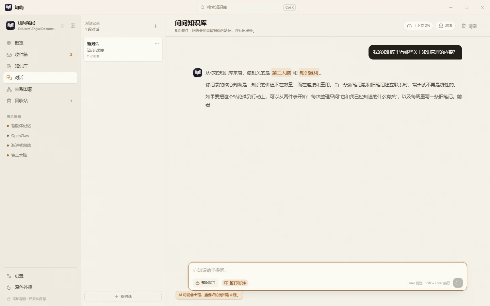
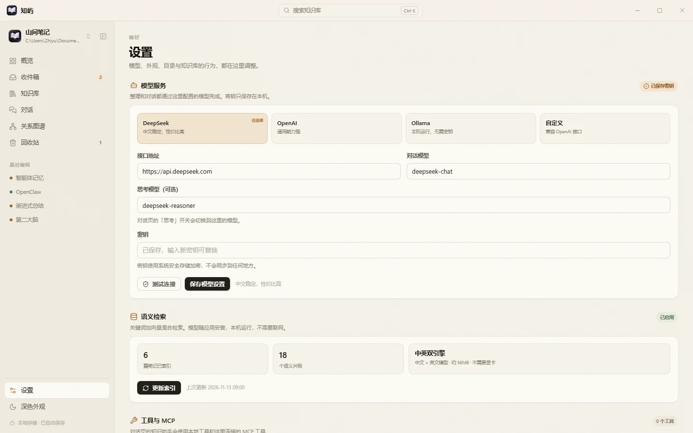
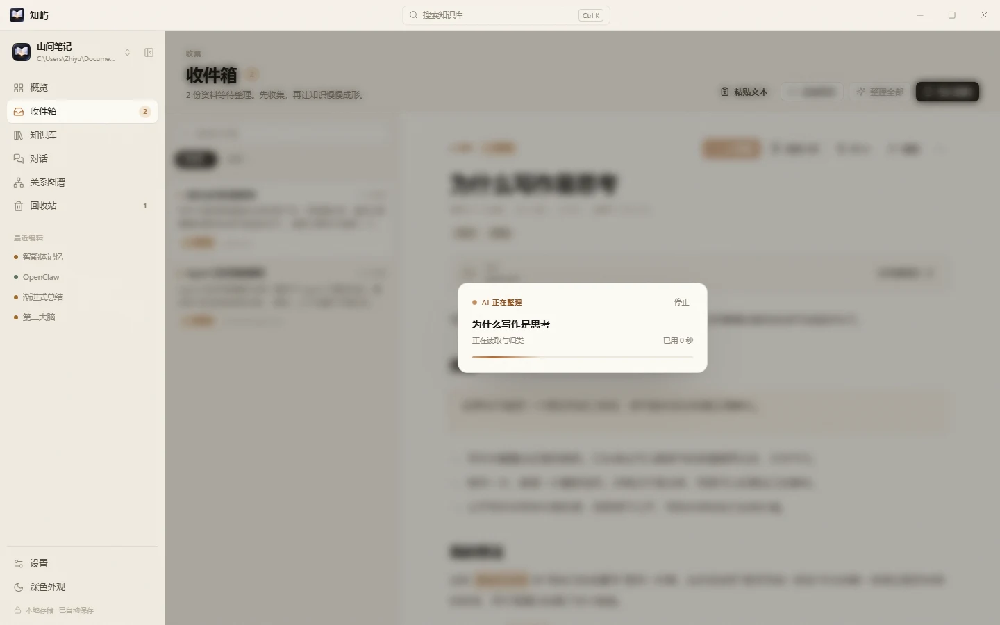

# 知屿

本地优先的 AI 个人知识库，Windows 桌面应用。

知屿把资料收集、知识整理和日常阅读放在同一个本地工作区里：网页、文本和 Markdown 文件先进入收件箱，AI 按你写的规则整理成概念、实体和来源，所有内容都以 Markdown 文件保存在本机。

## 界面预览



| 对话与来源 | 本地语义检索 |
| --- | --- |
|  |  |



## 主要能力

- **三层本地结构**：`raw/` 原始资料、`wiki/` 知识条目、`AGENTS.md` 整理规则。
- **AI 整理**：先展示新增与更新的条目预览，确认后才写入；自动更新索引和整理日志。
- **不经过 AI 直接入库**：原始资料可以原样保存为「来源」条目，不调用模型、不联网；大文件仍保留只读预览保护。
- **本地语义检索（RAG）**：内置中文小模型 `bge-small-zh-v1.5`，关键词 + 向量混合检索；首次打开自动建立索引，之后只处理变化的笔记，全程离线。
- **本地知识阅读**：双向链接、反向链接、全文搜索、阅读与编辑模式。
- **关系图谱**：根据条目之间的链接生成，可缩放、拖拽、点击打开。
- **多会话对话**：对话记录按会话保存，可新建、切换、重命名、删除。
- **上下文管理**：对话页可设置模型上下文窗口、查看估算占用、开启自动压缩或手动压缩；压缩后用摘要和最近消息继续对话，聊天记录不删除。
- **单一知识助手**：检索、研究、写作和整理建议合并为一个助手，可使用查收件箱、搜笔记、读笔记等本地只读工具，也可连接 stdio MCP Server 调用外部工具。
- **思考模式**：可配置独立的思考模型，在对话页一键切换。
- **知识库对话**：回答优先引用本地笔记，并在回答下方标出来源；从资料点「问 AI」会直接附带这篇原文。
- **可收起侧边栏**：主导航可以收成图标栏，状态会被记住。
- **版本快照**：使用本机 Git 记录每次整理，可在设置中撤销某次整理；可额外把每个版本备份为 `.bundle` 文件到独立目录。
- **回收站**：删除的笔记先进入应用内回收站，可恢复或永久删除。
- **目录可配置**：知识库位置、应用数据目录和快照备份目录都可以独立设置。
- **数据自有**：纯 Markdown 文件，不依赖云端账号，随时可迁移或备份。

## 开发

要求 Node.js 22+，Windows 10/11。

```bash
npm install
npm run dev        # Vite + Electron 开发模式
npm run build      # 类型检查并构建 renderer
npm test           # 本地仓库、RAG、Git 与 AI 链路测试
npm run dist       # 构建 Windows NSIS 安装包
```

语义检索使用的量化模型不放在 Git 仓库里。第一次开发前运行一次：

```bash
npm run setup:model
```

脚本会从 `hf-mirror.com` 下载 `bge-small-zh-v1.5` 的配置、分词器和量化 ONNX 模型到 `build/models/bge-small-zh-v1.5/`（约 23MB），已有文件会跳过；下载失败时会自动尝试 Hugging Face 官方源。模型采用 MIT 许可证，来源与声明见 `licenses/MODEL-NOTICE.txt`。

安装包会把 `build/models` 一起打包，因此终端用户不需要再下载。删除该目录会导致 RAG 不可用，但关键词检索和直接入库不受影响。

安装包输出到 `installer/`。

> 如果 Windows 文件监听或杀毒软件锁住 electron-builder 的临时 asar，打包会报 `EBUSY`。可把输出目录指到工作区外再打包：
> `npx electron-builder --win nsis --config.directories.output="%TEMP%/zhiyu-build-output"`。

## AI 配置

AI 整理与对话是可选的：不配置模型也可以导入资料、直接入库、查看笔记和使用本地 RAG 检索。

在「设置 → 模型服务」中配置任意兼容 OpenAI Chat Completions 的服务：

- DeepSeek
- OpenAI
- 本机 Ollama（`http://127.0.0.1:11434/v1`，通常不需要密钥）
- 其他自定义接口

密钥使用 Electron `safeStorage` 加密后保存在本机用户目录，不会同步到任何地方。

可选的思考模型会用于对话页的「思考」开关；MCP 配置在「设置 → 工具与 MCP」中填写。例如：

```json
[
  {
    "id": "filesystem",
    "name": "Filesystem",
    "command": "npx",
    "args": ["-y", "@modelcontextprotocol/server-filesystem", "C:\\notes"]
  }
]
```

MCP Server 以 stdio 方式启动，保存后应用会连接并读取工具列表。知识助手的本地工具为只读，不会自动改文件。

## 知识库结构

```text
knowledge-vault/
├─ raw/                  # 原始资料，只增不改
├─ wiki/
│  ├─ concepts/          # 概念
│  ├─ entities/          # 实体
│  ├─ sources/           # 来源摘要
│  └─ notes/             # 普通笔记
├─ AGENTS.md             # 整理规则，可直接编辑
├─ index.md              # 自动汇总的知识索引
└─ log.md                # 自动追加的整理日志
```

## 当前边界

- 导入支持 Markdown、纯文本、文本型 PDF、Word（`.docx`）、HTML 和公开网页，不限制文件大小。PDF 和 Word 会自动提取文字并转成 Markdown；超大 Markdown（超过 1MB）会以只读方式预览前 12 万字符，完整文件保留在磁盘上。
- 扫描版 PDF、旧版 `.doc`、图片型资料需要先做 OCR 或另存为 `.docx`；复杂表格的版式可能无法完整保留。
- 版本快照需要本机安装 Git；未安装时应用会自动隐藏或降级相关操作。
- 整理与对话质量取决于所配置的模型；应用不内置对话大模型，可选本机 Ollama 或任意 OpenAI 兼容接口。
- RAG 使用本地小模型，首次索引与后续增量更新都在本机 CPU 上完成；知识库很大时首次建立索引会占用一会儿 CPU。
- 网页剪藏支持大多数公开页面，需要登录或完全依赖脚本渲染的页面可能读取不到正文。

## 目录

```text
electron/               Electron 主进程、preload、本地仓库与 AI 服务
src/                    React renderer、页面与设计系统
tests/                  Node 测试
scripts/                图标、模型下载、截图与端到端冒烟脚本
build/                  应用图标与本地语义检索模型（模型不上传 Git）
licenses/               第三方模型与素材声明
```

## 许可证

项目代码采用 [MIT License](LICENSE)。内置的 `bge-small-zh-v1.5` 语义检索模型同样采用 MIT 许可证，来源和版权声明见 `licenses/MODEL-NOTICE.txt`。
